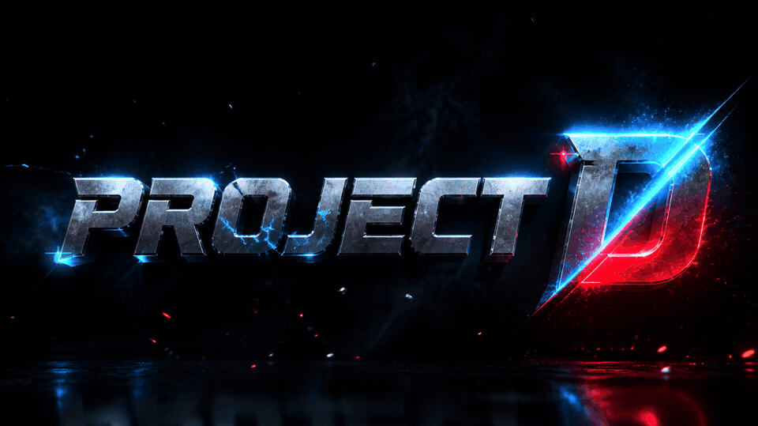
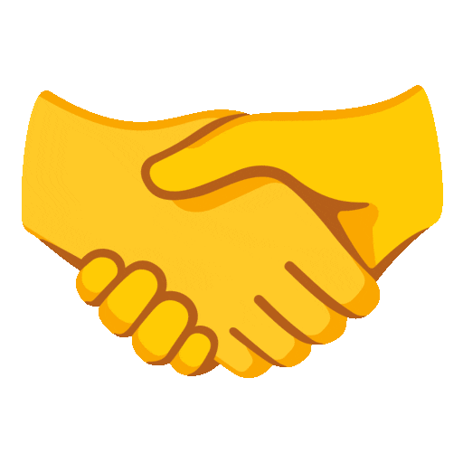

  <samp>
    Hi there! I'm <b>David</b> 
    EE Student | Engineering Developer | Vibe Coder Engineer
  </samp>

 

  

 

<strong>About Me</strong>

### EE Student | Engineering Developer | Vibe Coder Engineer

I'm an Electrical Engineering student at **CIT-U** in the Philippines. I build stuff, both **software and hardware**, so you'll find me working on anything from code to circuits.

I'm that person who loves making things, kind of **Iron Man-style**. I like figuring out how stuff works, then turning ideas into real projects. Right now I build software projects to help pay for the bigger ones.

##  How I Work

- **AI-assisted engineering:** I plan each feature, build with AI, then test, refine, and document it before release.
- **Right tool for the job:** I don't stick to one stack. I pick what works for each project.
- **Everything's documented:** My notes and projects live in Obsidian, in my own **Vault OS** vault.

##  My Philosophy

> **Learn. Build. Improve. Repeat.**

Every project teaches me something new, whether it's a quick script, a big engineering system, or a fun game. I learn by doing, because experience is the best teacher.

**Always learning. Always building.**

##  Let's Connect

Got a project or an idea? I'm open to collabs and freelance work. Look around, and say hi!

[GitHub](https://github.com/David-debug2) · [Project D on YouTube](https://www.youtube.com/@Project-D-2026)

##  Languages and Tools

I Used as of 2026:

##  Latest YouTube Videos

<!-- VIDEOS:START -->

<!-- VIDEOS:END -->

## Contribution Snake

<picture>
  <source media="(prefers-color-scheme: dark)" srcset="https://raw.githubusercontent.com/David-debug2/David-debug2/output/github-snake-dark.svg">
  <source media="(prefers-color-scheme: light)" srcset="https://raw.githubusercontent.com/David-debug2/David-debug2/output/github-snake.svg">
  
</picture>

[How this profile updates](MAINTENANCE.md)
