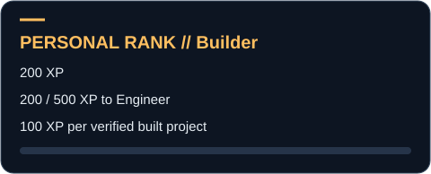
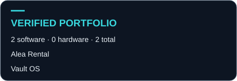
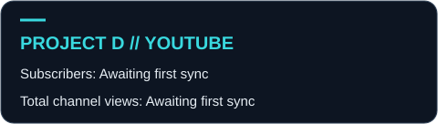

# About Me

### EE Student | Engineering Developer | Vibe Coder Engineer

I'm an Electrical Engineering student at **CIT-U** in the Philippines. I build stuff, both **software and hardware**, so you'll find me working on anything from code to circuits.

I'm that person who loves making things, kind of **Iron Man-style**. I like figuring out how stuff works, then turning ideas into real projects. Right now I build software projects to help pay for the bigger ones.

## 🧠 How I Work

- **Vibe coder engineer:** I use AI to prototype fast, then I review, test, and put it all together with an engineer's eye.
- **Right tool for the job:** I don't stick to one stack. I pick what works for each project.
- **Everything's documented:** My notes and projects live in Obsidian, in my own **Vault OS** vault.

## 🚀 My Philosophy

> **Learn. Build. Improve. Repeat.**

Every project teaches me something new, whether it's a quick script, a big engineering system, or a fun game. I learn by doing, because experience is the best teacher.

**Always learning. Always building.**

## 🤝 Let's Connect

Got a project or an idea? I'm open to collabs and freelance work. Look around, and say hi!

[GitHub](https://github.com/David-debug2) · [Project D on YouTube](https://www.youtube.com/@Project-D-2026)

## Languages & Tools

Languages used in my built software projects, Alea Rental and Vault OS:

    

**Tools & platforms:** React · Obsidian · Cloudflare · Supabase

## Latest YouTube Videos

<!-- VIDEOS:START -->
Awaiting first sync. [Watch Project D on YouTube](https://www.youtube.com/@Project-D-2026).
<!-- VIDEOS:END -->

## Builder Stats

<!-- STATS:START -->

**Personal rank:** Builder · 200 XP · 200 / 500 XP to Engineer.

**Verified portfolio entries:** 2 software · 0 hardware · 2 total.

Subscribers: Awaiting first sync · Total channel views: Awaiting first sync
<!-- STATS:END -->

How my personal portfolio rank works

This is my own game-style progress system. Each distinct built project in my [public registry](data/projects.json) earns **100 XP**. Demos, editions, templates, individual features, and this profile are excluded. It measures my portfolio progress, not an official developer rating.

| Rank | XP required |
| --- | ---: |
| Apprentice | 0 |
| Builder | 200 |
| Engineer | 500 |
| Inventor | 1,000 |
| Architect | 2,000 |

The launch registry contains **Alea Rental** and **Vault OS**. Hardware entries will be added as they are verified for this portfolio.

## Contribution Snake

<picture>
  <source media="(prefers-color-scheme: dark)" srcset="https://raw.githubusercontent.com/David-debug2/David-debug2/output/github-contribution-grid-snake-dark.svg">
  <source media="(prefers-color-scheme: light)" srcset="https://raw.githubusercontent.com/David-debug2/David-debug2/output/github-contribution-grid-snake.svg">
  
</picture>

[How this profile updates](MAINTENANCE.md)
